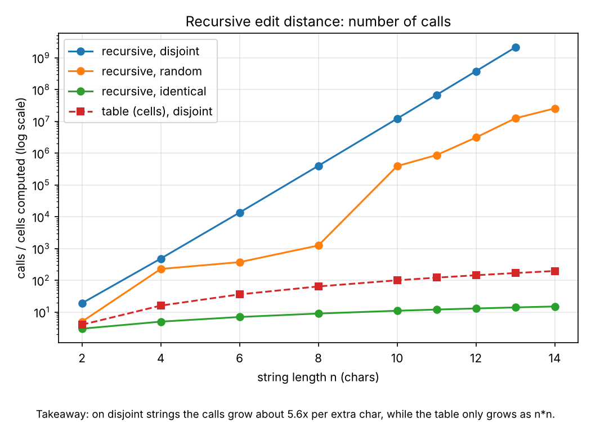
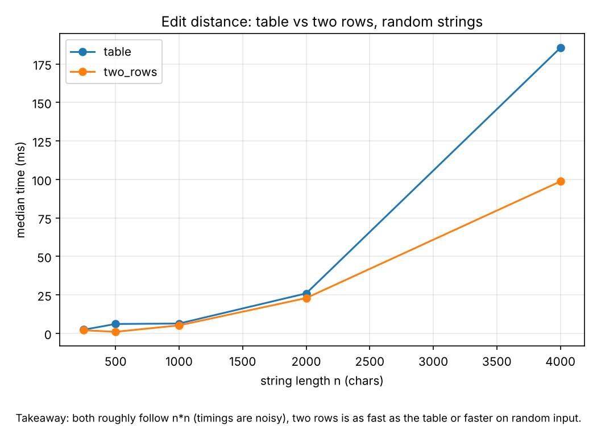
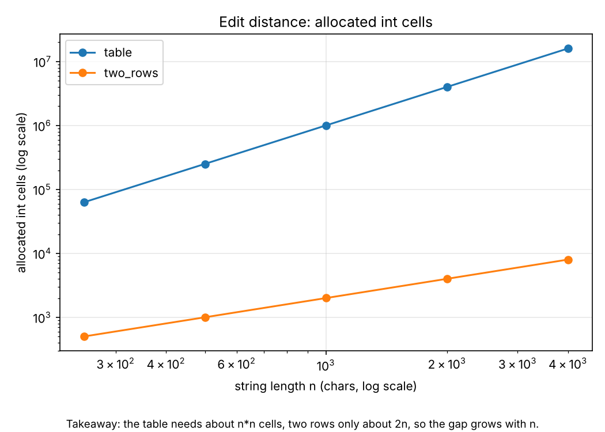
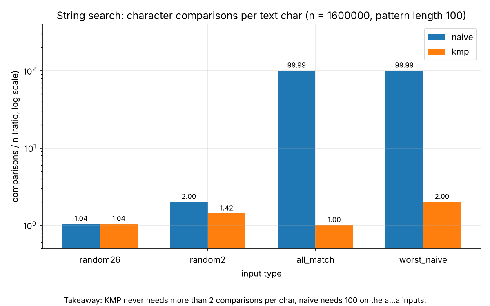
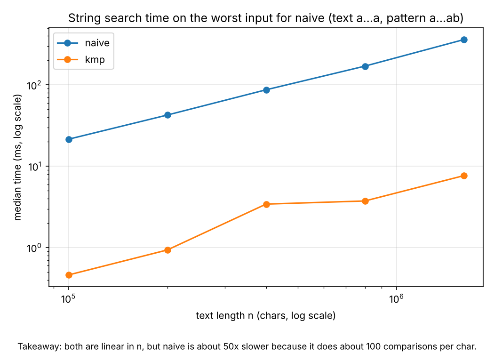

# Assignment 4 Report - Dynamic Programming and String Algorithms

Islam, SE-2509

## 1. Experiment Design Card

(Written before the first run. Changes after the first run are listed at the end of this section.)

| Field | What I wrote |
|---|---|
| **Question** | Edit Distance: does the recursive version really explode, and do table and two rows both cost n*m? Search: is KMP really linear on every input, and how much worse is naive on a bad input? |
| **Sizes (n)** | Edit Distance, small (all three versions): 2, 4, 6, 8, 10, 11, 12. Recursion can not handle big n, so this list is short. Edit Distance, big (table and two rows only): 250, 500, 1000, 2000, 4000 (16M cells at the top, runs in about 0.2 s and does not run out of memory). Search: text length 100k, 200k, 400k, 800k, 1.6M, pattern length always 100. Largest is at least 4x the smallest everywhere. |
| **Inputs** | Edit Distance: `random` (alphabet of 4 letters, the usual case), `identical` (a = b, best case for the recursion because it only goes along the diagonal), `disjoint` (a = "aaa..", b = "bbb..", no letter matches, worst case for the recursion). Search: `random26` (normal text), `random2` (binary text, many partial matches), `worst_naive` (text a...a, pattern a...ab, worst case for naive), `all_match` (text a...a, pattern a...a, a lot of overlapping matches). |
| **Metrics** | Edit Distance: operations (recursive = calls, DP = cells computed), memory_cells (ints allocated for the table / rows), time. Search: character comparisons (one per `charAt` comparison, also inside the LPS building), number of matches, time. Time is the median of 5 runs. I count the cost I want to explain: repeated work for the DP and comparisons for the search. |
| **Prediction** | Recursive on `disjoint`: the number of calls multiplies by about 5-6 for every extra char (theory says about 5.83), `identical` stays linear, `random` is in between. Table and two rows: operations are exactly n*n on every input, time grows about 4x when n doubles, memory is n*n cells for the table and about 2n for two rows. Naive on `worst_naive` and `all_match`: about 100 comparisons per char (pattern length), on random text close to 1-2 per char. KMP: at most about 2 comparisons per char on every input. |
| **Plots** | 1. Recursive calls vs n (log y): does the recursion explode? 2. Table vs two rows time vs n: is two rows slower? 3. Allocated cells vs n (log-log): how big is the memory gap? 4. Comparisons per text char for Naive vs KMP on each input (ratio, log y): which input is the worst case? 5. Search time on the worst input (log-log): does the ratio show up in the clock? |

**What I changed after the first run:** first I used sizes only up to 12 for the recursion, but it still ran in about 1 s, so I added 13 and 14 to find the place where it really stops (n = 13 takes about 5.5 s on `disjoint`, so the runner stops there with a 3 s limit). I also changed plot 4 from lines to bars at the biggest n, because the lines for different inputs lay on top of each other and nobody could read them.

## 2. Plots and Results

*Plot 1: on disjoint strings the number of calls grows about 5.6x for every extra char, while the table only grows as n*n.*

*Plot 2: both versions roughly follow n*n (timings are noisy), two rows is as fast as the table or faster on random input.*

*Plot 3: the table needs about n*n cells, two rows only about 2n, so the gap grows with n.*

*Plot 4: KMP never needs more than 2 comparisons per char, naive needs 100 on the a...a inputs.*

*Plot 5: both are linear in n, but naive is about 50x slower on this input because it does about 100 comparisons per char.*

Some numbers from `results.csv`:

| What | Value |
|---|---|
| Recursive, disjoint, n = 12 / 13 | 377,393,953 calls (1.06 s) / 2,114,900,428 calls (5.5 s) |
| Table, random, n = 4000 | 16,000,000 cells computed, 16,008,001 cells allocated, 185 ms |
| Two rows, random, n = 4000 | 16,000,000 cells computed, 8,002 cells allocated, 99 ms |
| Naive, worst_naive, n = 1.6M | 159,990,100 comparisons, 361 ms |
| KMP, worst_naive, n = 1.6M | 3,200,098 comparisons, 7.7 ms |

## 3. Prediction vs Result

**Edit Distance.** I expected exponential growth for the recursion on `disjoint`, and I got it: the calls went from 12,146,179 (n = 10) to 67,570,078 (n = 11) to 377,393,953 (n = 12), so about 5.6x per char, close to the 5.83 from theory. `identical` stayed linear (n + 1 calls) and `random` was much smaller than `disjoint` (3,092,815 calls at n = 12), so a test with only random strings would hide how bad the recursion is. For the DP versions the operations were exactly n*n on every input type (16,000,000 at n = 4000), as predicted, so the input type does not matter for them. One difference: I expected the time to grow 4x every time n doubles, but the clock was noisy (table random: 6.1 ms at n = 500 and 6.4 ms at n = 1000). I think it is JIT warm-up and garbage collection for the big table, and the counter shows the real 4x.

**String search.** Naive did 99.99 comparisons per char on `worst_naive` and `all_match` (predicted about 100), and 1.04 / 2.0 on `random26` / `random2`. KMP did 2.00 on `worst_naive` and 1.00 on `all_match`, so the "at most 2 per char" prediction was right. The surprise is the time of KMP on `all_match`: 103 ms at n = 1.6M, much more than 7.7 ms on `worst_naive` although it does fewer comparisons. The reason is that `all_match` has 1,599,901 matches, and storing them in an `ArrayList<Integer>` costs more than the comparisons. So the counter and the clock tell different stories here, and the clock was measuring the output size.

## 4. Short Answers

**Which input made your string search slowest, and why does it do that?**
For comparisons, `worst_naive` and `all_match` are tied for naive (about 100 per text char). The text is a...a, so naive matches almost the whole pattern at every start position, then shifts by one and does it all again. That is n*m comparisons. In time `all_match` was slightly slower (502 ms vs 361 ms at n = 1.6M) because it also stores 1.6M matches. KMP is slowest on `worst_naive` by comparisons (2 per char) because of the many fallbacks in the LPS table, but it is still linear.

**How large an n could the recursive Edit Distance handle, and what stopped it?**
On `disjoint` strings it handled n = 12 in about 1 s and n = 13 in about 5.5 s (2.1 billion calls). I stopped there with a 3 s limit in the runner, because n = 14 would need about 30 s and n = 15 several minutes. What stopped it is the time, not memory or the call stack, because the depth is only n + m. On `random` strings it was much better (n = 14 in 63 ms), because equal letters take only one branch, but I can not rely on that.

**What do you gain and what do you lose when you use two rows instead of the full table?**
We gain memory: at n = 4000 it is 8,002 cells instead of 16,008,001, about 2000x less, and the time was the same or better in my runs (99 ms vs 185 ms on random). We lose the full table, so we can not walk back through it to find which insertions, deletions and replacements were used, only the number. If the platform only needs the distance for ranking suggestions, two rows is enough.

**If you had to choose one string search for your city platform, which one and why?**
I would choose KMP. On normal random text naive and KMP are equal (1.04 comparisons per char both), but operators search very long logs where repeated patterns can happen, and there naive was about 50x slower (361 ms vs 7.7 ms). KMP has a guarantee of about 2 comparisons per char on every input, and naive does not. The price is a little more code and the LPS array, and for short street names naive would also be fine.

## 5. A Paragraph on Time

The measured times went from under 1 ms (small inputs) to about 500 ms (naive on 1.6M chars), each as the median of 5 runs on my laptop. They are not my only evidence because the clock depends on the machine, the JIT compiler, garbage collection and what else is running, and I saw that in the noisy table timings at n = 500 and 1000. Also the time of KMP on `all_match` was dominated by building the result list, not by the algorithm. The counters (calls, cells, comparisons) are the same on every run and every computer, so I use them to explain the shape of the curves, and the time only to check that the difference is also visible on a real clock.
